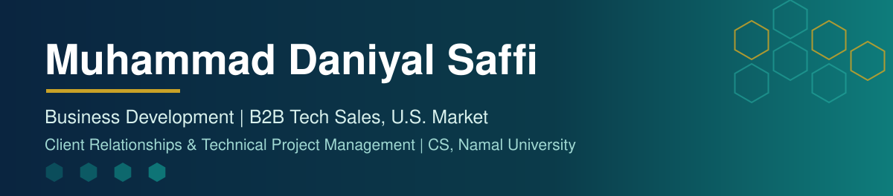
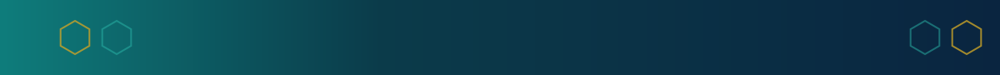

  

  
  
  

## About

Business development professional with a Computer Science degree and a year spent building a U.S. outbound pipeline from scratch for a software services firm, where I closed multiple high-value technology contracts across mobile development, AI, and custom enterprise software.

My background is a bit different from most people in this field. I trained as an engineer, built AI and cybersecurity systems during my degree, and spent my final year working directly with a German agritech company on a production research problem. That means I can qualify technical requirements properly, hold a credible conversation with the engineering lead who is really making the buying decision, and scope work that delivery teams can actually build.

Alongside that, I founded and run PixelTrimmers, a small creative studio with a team of editors and an international client base. Running it keeps me close to pricing, scoping, delivery and account management rather than only the pitch.

Outside of client work, I was elected Batch Representative for my graduating class at Namal, competing against two other strong candidates for votes across four departments, and I served on the executive committee of a student social impact society, teaching students from nearby rural communities.

I'm currently looking for a full-time business development, team lead, or project management role where a technical foundation and hands-on delivery experience are genuinely useful. Open to onsite, hybrid, or remote.

## What I Do

| Role | Where | Focus |
| --- | --- | --- |
| **Business Developer** | Mavericks Labs | Building the US-market outbound pipeline and driving B2B tech sales |
| **Founder & Project Manager** | PixelTrimmers | Running a video-editing studio serving international clients |
| **Teaching Assistant** | Namal University | Assisting with Discrete Structures |

## Skills

<strong>Business Development</strong>

<strong>Tools</strong>

<strong>Technical</strong>

## Featured Projects

| Project | Detail |
| --- | --- |
| **AI-Driven Honeybee & Beehive Health Monitoring System** | Final-year project built with SAWiE Ecosystem, Germany; 1st place at AgriFusion 2025 |
| **Open-Source SIEM Solution** | Security monitoring stack built with Wazuh, Grafana, Suricata, and MISP |

## GitHub Stats

  
  

  

## Connect

  
  
  

  

